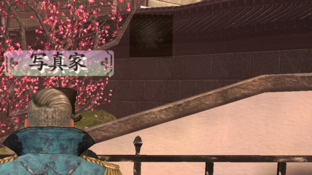
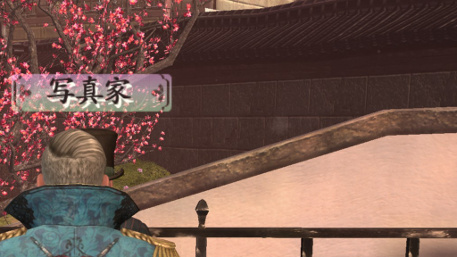

# White or black boxes around effects

- Status: confirmed in game
- Code: `src/mod.cpp` (`setRenderStateHook`, `installTranslucentDepthMask`), `src/translucent_depth.h` (`TranslucentDepthMask`); hooks `IDirect3DDevice9::SetRenderState` of the game's device, or `IDirect3D9::CreateDevice` until the device exists
- Tests: `translucent_depth_probe` (4 passed, 0 failed), `translucent_depth_native_probe` (17 passed, 0 failed, label `needs_exe`)
- Last updated: 2026-10-12

## Problem

Some effects, such as the glow (bloom) and the effect when you kick a character, show a square box around them. The box is white against a bright sky and black against dark backgrounds.

With `EnableDOF=0` in `S4-SETTINGS.ini` the boxes are gone, but so is depth of field.

For reference, the same part of one scene before and after the fix (cropped from 3840x2160 screenshots). Before the fix, a dark box floats above the wall, to the upper right of the "写真家" (photographer) label. After the fix it is gone.

| Before | After |
| --- | --- |
|  |  |

## Cause

- The scene is drawn to two render targets at once (set up at `0x541930`): the color, and a depth texture (render target 1) that depth of field reads.
- Every pixel shader of the scene material (`ColorDepthMaterial`) writes depth to `COLOR1` with alpha 1, whatever the texture's alpha is.
- In Direct3D 9, alpha blending and the color write mask apply to all render targets unless set separately, and the game never sets the mask of render target 1. So an effect quad changes the depth of its whole rectangle, transparent texels included: normal blending overwrites it, and additive blending adds to it.
- Depth of field (`DoF.fx`) uses that depth to choose how much to blur each pixel and, in one technique, how much to change its contrast. Only the rectangle of the quad changes, so a box appears that is brighter on bright backgrounds and darker on dark ones.

## Possible fixes

1. While alpha blending is on, do not write render target 1 (`D3DRS_COLORWRITEENABLE1 = 0`), by hooking `IDirect3DDevice9::SetRenderState`.
   - Pros: translucent draws already leave the Z buffer alone; this treats the depth texture the same way. One extra render state call only when blending is switched, nothing per draw. No game file is changed.
   - Cons / risks: anything that is drawn with blending but should give depth of field its depth (water, for example) now keeps the depth behind it. Needs `D3DPMISCCAPS_INDEPENDENTWRITEMASKS`, which current GPUs have.
2. Mask render target 1 when Z writing is off (`D3DRS_ZWRITEENABLE = FALSE`) instead.
   - Pros: matches the Z buffer exactly.
   - Cons / risks: the sky or other backgrounds drawn without Z writing would also lose their depth.
3. Replace the shaders in memory so that `COLOR1` carries the texture's opacity.
   - Pros: transparent texels keep the depth behind them, opaque texels still write theirs.
   - Cons / risks: many generated shaders to replace, and additive blending would still add depth. Much larger change.
4. Tell players to set `EnableDOF=0`.
   - Pros: no Mod needed.
   - Cons / risks: depth of field is lost.

## Chosen fix

Approach 1.

- When the Mod loads, it reads the game's device from the renderer (`[0x9e0890]` → `+0x720` → `+0x2238`) and hooks its `SetRenderState`. If the renderer has not created the device yet, it hooks `IDirect3D9::CreateDevice` of `d3d9.dll` (loaded by the same name as the game does) and hooks `SetRenderState` right after the game's device is created.
- In the hook, `D3DRS_ALPHABLENDENABLE` is passed on, then `D3DRS_COLORWRITEENABLE1` is set to 0 while blending is on, and back to the mask the game asked for (all channels by default) when it is off. A `D3DRS_COLORWRITEENABLE1` set by the game while blending is on is remembered and applied when blending ends. Other states pass through unchanged.
- At startup the Mod checks the bytes at `0x6e6466`, `0x88e0f0` and `0x88e109` (where the renderer pointer, the render state and the device offset come from) and the GPU capability `D3DPMISCCAPS_INDEPENDENTWRITEMASKS`. If any differs, this fix is skipped and the reason is written to `mod_loader.log`; the other fixes still load.
- `mod_loader.log` gets `translucent depth mask installed on IDirect3DDevice9::SetRenderState`, or `translucent depth mask waits for the game to create its Direct3D device` followed by the installed line when the device is created.
- Verified without the game: on a mapped copy of the exe with a fake device where the renderer keeps it, the hook gives the expected render states (blending on hides render target 1, off restores it, other states pass through), and the Mod skips the fix on a GPU without separate write masks. In the game, the boxes are gone with depth of field on, water looks the same as before, and `mod_loader.log` shows the installed line without the waiting line, so the device already existed when the Mod loaded (confirmed 2026-10-12). The cost per call was not measured; the hook adds one comparison to each `SetRenderState` and one call when blending changes.

## Notes

- If a d3d9 wrapper (ReShade, DXVK and so on) is in the game folder, the hook is placed on the wrapper's device. Not tested.
- If the game's device is replaced by a new one of another class, the new device is not hooked. The game creates one device at startup.
