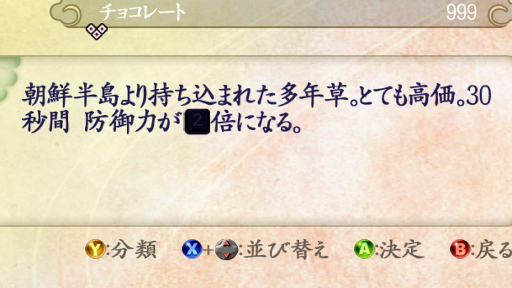
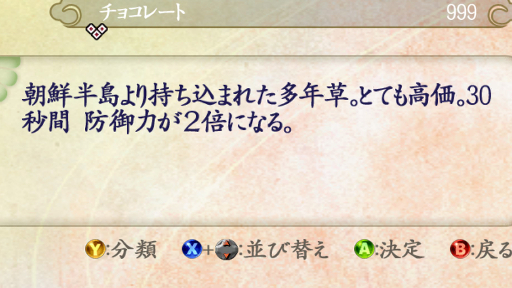
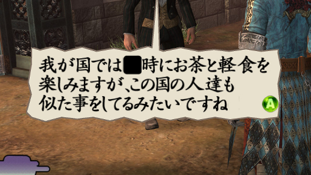
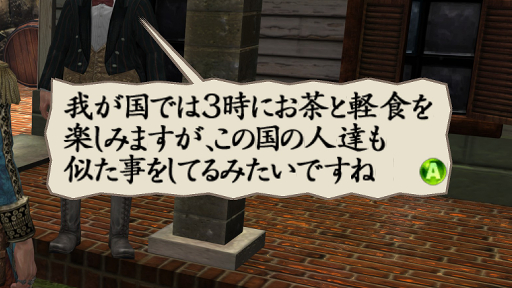

# Fullwidth digits shown as black boxes

- Status: confirmed in game for dialogue and item descriptions (screenshots below); numeric key images in input reassignment and tutorial prompts need in-game confirmation
- Code: `src/fullwidth_digits.h` (`findDigitGlyphs`, `separateDigitKeys`, `keepDigitKeyAliases`), `src/mod.cpp` (`prepareFontHook`, `keyGlyphHook`, `installFullwidthDigits`); hooks at `0x4c5530` and `0x68a330`
- Tests: `fullwidth_digits_probe` (48 passed, 0 failed), `fullwidth_digits_native_probe` (250 passed, 0 failed, label `needs_exe`); all 18 Mod tests passed
- Last updated: 2026-10-14

## Problem

Fullwidth digits (`０` to `９`) in dialogue and item descriptions appear as solid black boxes, so the number cannot be read. Halfwidth digits are not affected: in the item description below, the halfwidth `30` is readable but the fullwidth `２` is a box.

Input reassignment and tutorial prompts show numeric keys as key images. Those images must stay as they are.

For reference, the same text before and after the fix (cropped from in-game screenshots). The item description reads "防御力が２倍になる" (defense doubles), and the dialogue reads "我が国では３時にお茶と軽食を" (in my country, we have tea and a light meal at three). The two dialogue screenshots were taken at different places.

| Before | After |
| --- | --- |
|  |  |
|  |  |

## Cause

- The font database (`Font/FontDatabase.l`) registers each fullwidth digit twice under the same character code: the normal glyph on page 0, and the numeric key image on page 1 (the keyboard atlas).
- When the font is loaded (`0x4c5530`), every record is stored in the lookup table by its character code without checking for an earlier one, so the later key image replaces the normal digit.
- The font shader multiplies the selected image by the text color. With black text, both the key's background and its digit turn black, so the whole key becomes a black box.
- Input reassignment and action tokens in tutorial text convert a key to a character code with a shared converter (`0x68a330`, table at `0x99c948`), which returns the same fullwidth codes. They rely on the collision to show the key images.

## Possible fixes

1. Give the numeric key images separate character codes and return those from the key converter.
   - Pros: the existing digit glyphs, key images and widths are all kept. Covers every text source (item text, dialogue and others) at once. Work is done only when a font is loaded.
   - Cons / risks: font loading and the key converter must change together. The private codes must be unused in the loaded font.
2. Convert fullwidth digits in text to halfwidth digits.
   - Pros: uses glyphs that already work.
   - Cons / risks: changes the look and spacing, and every text source (item text, dialogue scripts and others) must be covered.
3. Change the shader, or force white color for these characters.
   - Pros: makes the key image readable.
   - Cons / risks: text still shows a key image instead of a digit, and other glyphs may be affected.

## Chosen fix

Approach 1.

- At startup the Mod checks the bytes at `0x4c5530`, `0x4c55d7`, `0x4c5620` and `0x68a330`, and that the key table maps the ten digit keys to `U+FF10` to `U+FF19`. If any differs, or another Mod has claimed either range, this fix is skipped and the reason is written to `mod_loader.log`; the other fixes still load. Both hooks are installed together or not at all.
- When the game loads a font, before it builds the lookup table, the Mod checks that all ten digits have exactly one normal glyph and one key image at the known place in the keyboard atlas, and that `U+E010` to `U+E019` are unused. Then it changes only the ten key image records to `U+E010` to `U+E019`. Normal digits keep their codes. No textures or files are replaced.
- The key converter hook returns the matching private code for the ten digit keys, only after a font was separated. Other keys and the missing-key result are unchanged. The hook does only comparisons and a subtraction, with no allocation, file I/O, locking or logging.
- If a loaded font is not the known one, its records and the original key conversion are kept. Strings already converted to private codes stay readable by aliasing them to the digit entries, without overwriting private glyphs that font defines. A later supported font enables separation again.
- `mod_loader.log` gets `fullwidth digits installed at 0x4c5530 and 0x68a330; waiting for font loading` at startup, and `fullwidth digits: separated 10 numeric key images from the normal digit glyphs` (or why the font was left unchanged) each time a font is loaded. Nothing is logged per character.
- The setting is `[fullwidth_digits] enabled=1` (default); `0` leaves the original behavior.
- Verified without the game: with synthetic font records and a mapped copy of the exe (allocation and the assigned-key query replaced, texture creation skipped), normal digits are found, key image coordinates and widths are unchanged, all 98 key mappings are as expected, the tutorial token code gives the private codes after assigning each numeric key, controller tokens are unchanged, and unsupported fonts, private code collisions, reloads, the setting and the startup checks behave as described. Rendering on a GPU is not covered.
- In the game: the fullwidth digits in the item description and the dialogue above are readable (confirmed 2026-10-14).
- Needs in-game confirmation: numeric keys in input reassignment, tutorial prompts after reassigning a numeric key, line wrapping, and font or language reloads.
- Runtime cost was not measured; the key converter hook adds three comparisons to each call.

## Notes

- This fix covers `０` to `９` only. Some fullwidth punctuation and symbols (such as `，．；［］－＝`) collide with key images in the same way and are outside its scope.
- The Mod changes loaded memory only. Game files and saves are not modified.
- A replacement font that already uses `U+E010` to `U+E019` disables the separation; the log says so.
